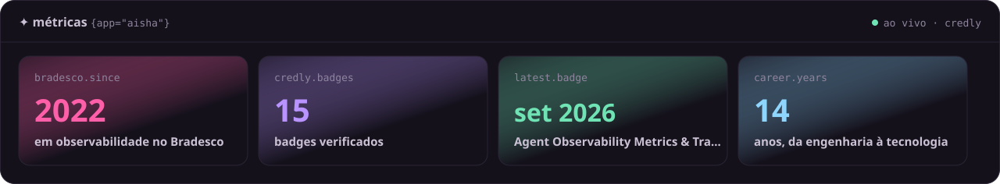

<!-- Este arquivo é gerado por scripts/build_readme.py. Edite lá e rode o script. -->

  
  
  
  
  
  

<picture>
  <source media="(prefers-color-scheme: light)" srcset="assets/title-sobre-light.svg">
  
</picture>

Engenheira civil e ambiental que virou **engenheira de software**. Hoje sou **Software Engineer I no Bradesco**, no time de **observabilidade**: cuido de dashboards e alertas das jornadas críticas do banco, como o PIX, e participo da migração da monitoração de negócio para **Grafana, Mimir e OpenTelemetry**.

- 🔭 &nbsp;**Agora:** métricas na origem com OpenTelemetry, dashboards que respondem perguntas e alertas sem falso positivo
- 🎓 &nbsp;**Formação:** pós em DevOps &amp; Continuous Software Engineering (PUC Minas) · engenharias civil e ambiental (UNIVALE)
- 🌱 &nbsp;**Estudando:** Kubernetes, OpenShift, GitOps e IA aplicada à observabilidade
- 💻 &nbsp;**Por hobby:** criar sites e ferramentas, como o meu [portfólio](https://amanda.eng.br) e a [Biblioteca de Sobrália](https://biblioteca-sobralia.pages.dev)
- 🦇 &nbsp;**Fora do expediente:** Paramore no fone, Warzone e MapleStory como *Aisha*, terror com zumbis e saudade da Islândia

🇬🇧 <b>English</b>

 
Civil and environmental engineer turned <b>software engineer</b>. I'm a <b>Software Engineer I at Bradesco</b>, one of Brazil's largest banks, on the <b>observability</b> team: I build dashboards and alerts for critical journeys such as PIX instant payments, and I'm part of the migration of business monitoring to <b>Grafana, Mimir and OpenTelemetry</b>. Postgraduate degree in DevOps &amp; Continuous Software Engineering (PUC Minas). More at <a href="https://amanda.eng.br/?lang=en">amanda.eng.br</a>.

 

<picture>
  <source media="(prefers-color-scheme: light)" srcset="assets/title-stack-light.svg">
  
</picture>

<code>observabilidade</code> 
     

<code>devops & cloud</code> 
       

<code>código</code> 
     

<picture>
  <source media="(prefers-color-scheme: light)" srcset="assets/title-projetos-light.svg">
  
</picture>

<table>
<tr>
<td width="50%" valign="top">
<b>🦇 amanda.eng.br</b> 
Meu portfólio: gótico, dark e rosa. Badges do Credly e repositórios atualizados sozinhos via GitHub Actions.  
<a href="https://amanda.eng.br">ver no ar ↗</a> · <a href="https://github.com/amandagusmao/meu-portfolio">código ↗</a>
</td>
<td width="50%" valign="top">
<b>📚 Biblioteca Digital de Sobrália</b> 
Sistema da biblioteca pública de Sobrália/MG: acervo, empréstimos por QR Code, cursos e carteirinha digital. Custo zero para a prefeitura.  
<a href="https://biblioteca-sobralia.pages.dev">ver no ar ↗</a> · <a href="https://github.com/amandagusmao/biblioteca-sobralia">código ↗</a>
</td>
</tr>
<tr>
<td width="50%" valign="top">
<b>📈 Grafana Chat Assistant</b> 
Plugin para o Grafana com um assistente de IA que cria dashboards a partir de linguagem natural, com lab de OpenTelemetry e Prometheus.  
<a href="https://github.com/amandagusmao/grafana-chat-box">código ↗</a>
</td>
<td width="50%" valign="top">
<b>🌳 Meu primeiro site</b> 
Feito em 2021 para a minha mini empresa de engenharia, antes de eu saber qualquer coisa de TI. Guardado com carinho.  
<a href="https://amandagusmao.github.io/Meu-Site/">ver no ar ↗</a> · <a href="https://github.com/amandagusmao/Meu-Site">código ↗</a>
</td>
</tr>
</table>

<picture>
  <source media="(prefers-color-scheme: light)" srcset="assets/title-artigos-light.svg">
  
</picture>

- ✦ [**Do legado à autonomia: a jornada para o Grafana**](https://bradesco.io/bradesco-tech-blog/busca?shareid=143) · Bradesco Tech Blog · out 2026
- ✦ [**A importância dos Dashboards no monitoramento e observabilidade de sistemas modernos**](https://bradesco.io/bradesco-tech-blog/busca?shareid=28) · Bradesco Tech Blog · ago 2025

 

  Quer me conhecer melhor? Visite <a href="https://amanda.eng.br"><b>amanda.eng.br</b></a> · feito com 🖤 e muito Paramore

